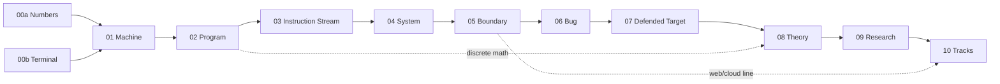

# Nand2ZeroDay
**Open Security Vulnerability Research™**

`from zero` · `to original research` · `~2,900 - 4,000h core` · `free-first`

A self-paced, dependency-ordered path from no computer science background to finding, exploiting and disclosing vulnerabilities nobody handed you. It required no degree: your published work is the credential.

## Principles

1. **Competence over attitude.** You leave a module by passing its gate. Reading the material doesn't count.
2. **Build before you break.** You write a network service before attacking protocols, implement crypto before breaking it, and build an interpreter before attacking a JIT.
3. **Read code and write code.** Assembly at reading fluency is a foundation, not a specialism.
4. **Theory separates researchers from technicians.** Finding a *new* bug class takes knowing where the machinery's assumptions fail.
5. **Your public work is the credential.** Writeups, exploits, patches and advisories count for more than certifications.
6. **Authorization is the boundary, and it is written down.** No skill level makes the document stop mattering.

## Curriculum Structure

| # | Module | Goal | Hours |
|---|--------|------|-------|
| **Prerequisites** | | | |
| 00a | [The Numbers](prerequisites/00a-the-numbers.md) | School math rebuilt: arithmetic to logarithms and notation. | 80 - 150 |
| 00b | [The Terminal](prerequisites/00b-the-terminal.md) | Shell, editor, git, Python, a Linux VM. | 40 - 80 |
| **Core** | | | |
| 01 | [The Machine](core/01-the-machine.md) | What a computer physically does, from NAND to CPU. | 45 - 75 |
| 02 | [The Program](core/02-the-program.md) | C, memory, data structures, discrete math. | 320 - 480 |
| 03 | [The Instruction Stream](core/03-the-instruction-stream.md) | Read x86-64 without a decompiler. | 200 - 300 |
| 04 | [The System](core/04-the-system.md) | Loader, kernel, syscalls, binary formats, networking. | 300 - 420 |
| 05 | [The Boundary](core/05-the-boundary.md) | Trust boundaries in access control, crypto, web and law. | 250 - 380 |
| 06 | [The Bug](core/06-the-bug.md) | Memory corruption with mitigations off. | 480 - 700 |
| 07 | [The Defended Target](core/07-the-defended-target.md) | Mitigations on, reliably, on two architectures. | 550 - 850 |
| 08 | [The Theory](core/08-the-theory.md) | Automata, compilers, dataflow, static analysis. | 160 - 260 |
| 09 | [The Research](core/09-the-research.md) | Audit, fuzz, triage, disclose. | 600 - 1,000+ |
| **Tracks** | | | |
| 10 | [Tracks](tracks/README.md) | One or two specialisations, past the published edge. | 600+ each |

M7 is the employability line, for exploit development and offensive security engineering. M8-10 are what research takes.

M1–M9 sum to 2,905–4,465 h, with M9 open-ended; the prerequisites add 120–230 h from a 9th-grade starting point. At 10 h a week that is six to nine years to M9. M2 and M7 are the likeliest overruns.

### Dependency graph

### Prerequisites

[00a · The Numbers](prerequisites/00a-the-numbers.md) and [00b · The Terminal](prerequisites/00b-the-terminal.md) run in parallel; both gates open M1. 00a rebuilds school math from wherever you stopped. 00b is the shell, git, Python and a Linux VM. If either is already true of you, take its gate cold and move on.

Every resource on this path is in English. If technical English is slow for you, that time is part of the prerequisites: read with a dictionary, not a translator.

### Core

[M1-9](core/) are the shared foundation. Everyone walks the same road. Each module has the same parts:

- **Requires:** the gate that must be passed first.
- **Outcomes:** what you can do on exit.
- **Resources**, tagged by role:
  - `Core`: do it.
  - `Alt`: a swap for a Core item, not an addition.
  - `Ref`: look things up in it; don't read it cover to cover.
  - `Paper`: read the original.
  - `Practice`: reps.
- **Milestones:** rough hour marks to check pace against.
- **Ship:** the public artifact that closes the module.
- **Gate:** an unaided pass/fail test, taken under the [gate protocol](gates/README.md): logged first, target drawn, no examiner but the log.

### Tracks

[Specialisations](tracks/README.md) open after M9. The exception is the web/cloud line, which can run in parallel with M6–M7 once the M5 gate is passed; see the [M5 fork](core/05-the-boundary.md#fork). Choose on evidence of where you are strongest, and choose at most two.

## Placement

Every gate is also the entry test for the next module. Take the gates cold, in order, and start at the first one you fail. The table shows where each background usually first fails, not which gates to skip: every gate before that still has to be passed.

| Background | Usually first fails at |
|------------|------------------------|
| Left school math early | 00a: take its course challenges first |
| Never used a terminal | 00b |
| Sysadmin / IT, some scripting | 00a's logarithms, or 02 |
| Web or application developer | 02 (the stack-frame drawing) |
| C / Rust systems engineer | 03 |
| Network engineer, SOC / blue team | 02 or 03 |
| CS graduate | 04 |
| CTF exploitation player | 05 (the legal part), then 07 (reliability) |

These are estimates. Cold placement attempts follow the [gate protocol](gates/README.md) but don't count toward Rule 1. Nobody skips the [M5](core/05-the-boundary.md) legal gate, M5 Ship 3 (your written authorization and law summary), or the 14-day shipping rule.

## Guides

- [Legal scope, lab and disclosure](guides/legal-and-lab.md)
- [Spending: hardware, books, courses, certifications](guides/spending.md)
- [Pitfalls: failure modes and their early symptoms](guides/pitfalls.md)
- [Gate protocol](gates/README.md) and the [M5 scenario bank](gates/m05-legal-scenarios.md)
- [Progress tracker](progress.md)

## Scope

Nand2ZeroDay produces a researcher capable of independent discovery in one domain. It does **not** cover cryptanalysis of primitives, baseband/TEE, automotive/ICS, full multi-boundary chains, or red-team operations (C2, implants, EDR evasion). Each of those needs dedicated work beyond this path.

## Known gaps

- No free structured resource exists for CET/shadow-stack bypass or the Windows heap, and M7's gate doesn't test shadow stacks, PAC/BTI or MTE because no free target set exists.
- No resource exists for the core activity of M9: choosing a target on your own and auditing it until something gives.
- Hour estimates are judgement, not data. Recalibrate after M2.
- Kernels, browsers, hypervisors, mobile, firmware and memory-safe-language targets are [candidate tracks](tracks/README.md#candidate-tracks), not yet written.

---
